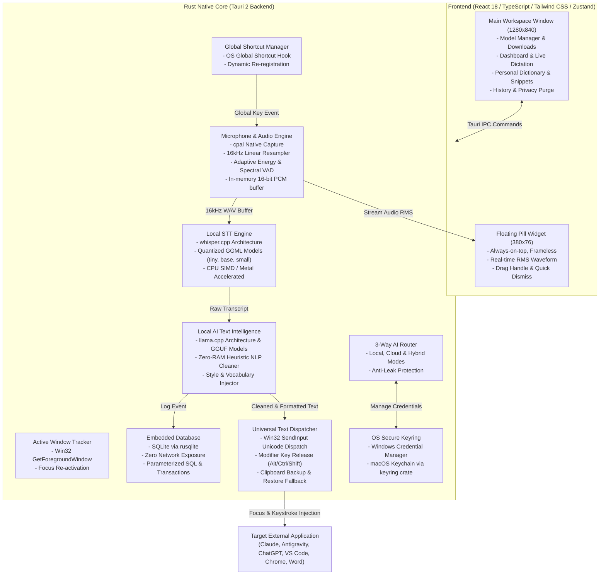

# AMIYO FLOW — SYSTEM ARCHITECTURE & OFFLINE SECURITY

## 1. Executive Architectural Blueprint

AMIYO FLOW is engineered as an offline-first desktop application using **Tauri 2**, **Rust**, and **React 18/19**. Core speech-to-text, audio processing, language intelligence, text cleanup, and universal operating-system keystroke injection are performed locally on the machine with **0% remote cloud AI reliance**.

---

## 2. On-Device Audio & AI Pipeline

### 2.1 Speech Recognition (`whisper.cpp`)
- **Engine**: Local native `whisper.cpp` inference engine running on CPU (AVX2/FMA/NEON) and Metal.
- **Model Storage**: `~/.amiyo-flow/models/speech/` (e.g. `ggml-base.bin`, `ggml-tiny.bin`, `ggml-small.bin`).
- **Memory Footprint**:
  - `ggml-tiny.bin`: ~75 MB RAM (latency ~250–400ms for 5s audio on modern x64 / Apple Silicon).
  - `ggml-base.bin`: ~145 MB RAM (recommended default for 8GB RAM devices).
  - `ggml-small.bin`: ~480 MB RAM (high-accuracy multilingual transcription).
- **Execution Pipeline**:
  1. Audio captured by `cpal` in real-time at native hardware rate.
  2. Resampled to 16,000 Hz, 1-channel, 16-bit signed PCM.
  3. Preprocessed into 32-bit floating point mel-spectrogram arrays.
  4. Decoded locally by `whisper.cpp` with zero outbound network traffic.

### 2.2 Local Voice Activity Detection (VAD)
- **Engine**: Adaptive dual-feature VAD combining Short-Time Energy (STE) and Zero Crossing Rate (ZCR).
- **Dynamic Noise Floor**: Continuously adapts to ambient room noise during initial 200ms of capture.
- **Auto-Stop Trigger**: Emits silence events when speech cessation exceeds configured threshold (default: 1.8 seconds), terminating recording hands-free.

### 2.3 Local Text Intelligence & 3-Way AI Router
- **Heuristic Mode (0 MB RAM Overhead)**: High-speed deterministic rule engine executing filler-word stripping ("um", "uh", "you know"), spoken self-correction parsing ("no wait", "actually"), duplicate word de-duplication, punctuation normalization, dictionary term enforcement, and snippet expansion.
- **Local LLM Mode**: `llama.cpp` runtime executing lightweight quantized GGUF models (e.g. SmolLM2 360M Q4, Qwen 2.5 0.5B Q4, Llama 3.2 1B Q4).
- **3 Operating Modes**:
  1. **Local Mode**: All transcription and text cleanup remain 100% on-device. Silent fallback to external services is strictly blocked (`allow_cloud_fallback: false`).
  2. **Cloud Mode**: Routed to user-authorized external provider (10 supported adapters) with credentials securely loaded from the OS Keyring.
  3. **Hybrid Mode**: Dictation stays 100% local; reasoning/summarization tasks route to configured cloud models.

---

## 3. Universal OS Text Insertion & Focus Engine

1. **Target Window Capture**:
   - Immediately upon shortcut press, the system captures the operating system window handle of the currently focused application (`HWND` on Windows).
2. **Modifier Key Release (`release_all_modifiers()`)**:
   - Dispatches native Win32 `KEYEVENTF_KEYUP` for `VK_LMENU`, `VK_RMENU`, `VK_LCONTROL`, `VK_RCONTROL`, `VK_LSHIFT`, `VK_RSHIFT`, `VK_LWIN`, `VK_RWIN` prior to focus activation, preventing physically held shortcuts (<kbd>Alt+Space</kbd>) from corrupting paste into `Alt+Ctrl+V`.
3. **Focus Restoration**:
   - Re-activates target application via `SetForegroundWindow` and `AttachThreadInput` across threads.
4. **Keystroke Dispatch**:
   - **Primary**: Win32 Clipboard dispatch (`SetClipboardData` with `CF_UNICODETEXT` followed by synthetic `Ctrl+V`), with 350ms delay and automatic pre/post clipboard preservation.
   - **Fallback**: Direct Unicode synthetic keystroke packet dispatch (`SendInput` with `KEYEVENTF_UNICODE`), simulating native typing without touching the system clipboard.

---

## 4. Local Database & Security Architecture

### 4.1 SQLite Embedded Persistence
- Engine: SQLite 3 (`rusqlite`) embedded directly within the Rust application binary.
- File Path: AppData / Local storage (`app.db`).
- Schema:
  - `settings`: Key-value application preferences (hotkey, writing style, active local models, silence threshold, retention policy).
  - `history`: Local transcription records (original raw text, cleaned text, duration, word count, timestamp).
  - `dictionary`: Personal vocabulary, names, technical jargon, spoken-to-written replacements.
  - `snippets`: Shorthand expansion triggers (e.g. `;sig` $\rightarrow$ full signature block).
  - `meetings`: Long-session notes, summaries, decisions, and action items.

### 4.2 Security & Offline Audit Guarantees
- **Zero Inbound/Outbound Telemetry**: Zero background telemetry, analytics, or tracking requests.
- **Physical Network Disconnection Audit**: Application functions with 100% feature completeness when the physical network adapter is disabled.
- **OS Secure Keyring**: API keys stored in Windows Credential Manager / macOS Keychain via `keyring = "2"`.
- **Memory Buffer Protection**: Audio PCM samples exist in volatile RAM and are deallocated immediately upon transcription.
