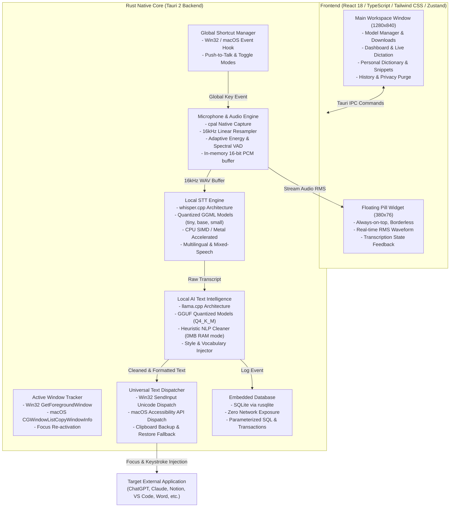

# AMIYO FLOW — 100% ON-DEVICE SYSTEM ARCHITECTURE

## 1. Executive Architectural Blueprint

AMIYO FLOW is engineered as an offline-first desktop application using **Tauri 2**, **Rust**, and **React 18/19**. Core speech-to-text, audio processing, language intelligence, text cleanup, and universal operating-system keystroke injection are performed exclusively on the local machine with **0% remote cloud AI reliance**.

---

## 2. On-Device AI Pipeline

### 2.1 Speech Recognition (`whisper.cpp`)
- **Engine**: Local native `whisper.cpp` inference engine running on CPU (AVX2/FMA/NEON) and Metal.
- **Model Storage**: `~/.amiyo-flow/models/speech/` (e.g. `ggml-base.bin`, `ggml-tiny.bin`, `ggml-small.bin`).
- **Memory Footprint**:
  - `ggml-tiny.bin`: ~75 MB RAM (latency ~250-400ms for 5s audio on M1 / Modern x64 CPU).
  - `ggml-base.bin`: ~145 MB RAM (recommended baseline for 8GB RAM devices).
  - `ggml-small.bin`: ~480 MB RAM (high-accuracy multilingual transcription).
- **Execution Pipeline**:
  1. Audio captured by `cpal` in real-time at native hardware rate.
  2. Resampled to 16,000 Hz, 1-channel, 16-bit signed PCM.
  3. Preprocessed into 32-bit floating point mel-spectrogram arrays.
  4. Decoded locally by `whisper.cpp` with zero outbound network traffic.

### 2.2 Local Voice Activity Detection (VAD)
- **Engine**: Adaptive dual-feature VAD combining Short-Time Energy (STE) and Zero Crossing Rate (ZCR), with optional local Silero VAD ONNX model runner.
- **Dynamic Noise Floor**: Continuously adapts to ambient room noise during initial 200ms of capture.
- **Auto-Stop Trigger**: Emits silence events when speech cessation exceeds configured threshold (default: 1.8 seconds), terminating recording hands-free.

### 2.3 Local Language Model & Heuristic Intelligence (`llama.cpp`)
- **Dual-Mode Text Cleanup**:
  - **Heuristic Mode (0 MB RAM Overhead)**: High-speed deterministic rule engine executing filler-word stripping ("um", "uh", "you know"), spoken self-correction parsing ("no wait", "actually"), duplicate word de-duplication, punctuation normalization, dictionary term enforcement, and snippet expansion.
  - **Local LLM Mode**: `llama.cpp` runtime executing lightweight quantized GGUF models (e.g. SmolLM2 360M Q4, Qwen 2.5 0.5B Q4, Llama 3.2 1B Q4) loaded lazily on demand and unloaded after prolonged inactivity to preserve system memory on 8GB machines.

---

## 3. Universal OS Text Insertion Architecture

1. **Target Window Capture**:
   - Immediately upon shortcut press, the system captures the operating system window handle of the currently focused application (`HWND` on Windows, window ID on macOS).
2. **Focus Restoration**:
   - When transcription and text processing complete, the target window is explicitly re-activated via `SetForegroundWindow` and `AttachThreadInput` to guarantee input focus is active.
3. **Keystroke Dispatch**:
   - **Primary**: Direct Unicode synthetic keystroke packet dispatch (`SendInput` with `KEYEVENTF_UNICODE`), simulating native typing into native controls, Electron apps, web browsers, and document editors without touching the system clipboard.
   - **Fallback**: Windows Clipboard dispatch (`SetClipboardData` with `CF_UNICODETEXT` followed by synthetic `Ctrl+V`), with automatic pre-capture and restoration of the user's prior clipboard buffer.

---

## 4. Local Database Architecture

- Engine: SQLite 3 (`rusqlite`) embedded directly within the Rust application binary.
- File Path: AppData / Local storage (`app.db`).
- Schema:
  - `settings`: Key-value application preferences (hotkey, writing style, active local models, silence threshold, retention policy).
  - `history`: Local transcription records (original raw text, cleaned text, duration, word count, timestamp).
  - `dictionary`: Personal vocabulary, names, technical jargon, spoken-to-written replacements.
  - `snippets`: Shorthand expansion triggers (e.g. `;sig` $\rightarrow$ full signature block).
  - `meetings`: Long-session notes, summaries, decisions, and action items.
