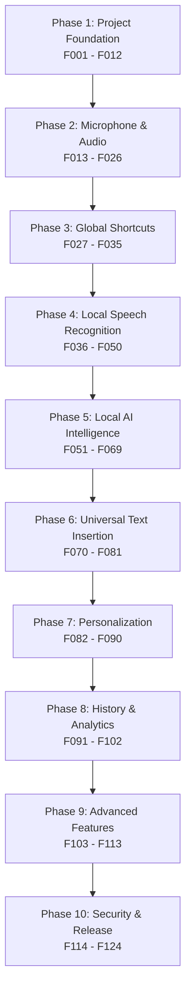

# AMIYO FLOW — IMPLEMENTATION ROADMAP (PHASES 1–10)

This roadmap documents the sequence of development for AMIYO FLOW from project inception to production release.

---

## Phase Breakdown

### Phase 1 — Project Foundation (F001–F012)
- Architecture design, dual-window configuration (main workspace + floating pill widget), custom title bar with native window controls, system tray, and SQLite settings persistence.

### Phase 2 — Microphone & Audio (F013–F026)
- Native `cpal` audio enumeration, 16kHz linear resampling, real-time RMS meter streaming (~30Hz), canvas soundwave visualizer, pause/resume, and dedicated audio worker thread.

### Phase 3 — Global Shortcuts (F027–F035)
- Native OS global shortcut listener (`Ctrl+Shift+Space`), toggle-to-talk, hold-to-talk, conflict detection, and settings recovery.

### Phase 4 — Local Speech Recognition (F036–F050)
- On-device speech recognition architecture with `whisper.cpp` compatibility, local model loading/unloading, multilingual prompt conditioning (English, Hindi, Bengali, Hinglish), and offline operation.

### Phase 5 — Local AI Intelligence (F051–F069)
- Local text cleanup with `llama.cpp` compatibility, 0MB RAM heuristic normalizer, filler word removal, repetition elimination, spoken self-correction, and 6 specialized writing styles.

### Phase 6 — Universal Text Insertion (F070–F081)
- Active window handle capture, Win32 `SendInput` Unicode keystroke packet dispatch, clipboard fallback with automatic restoration, and multiline support across external apps.

### Phase 7 — Personalization (F082–F090)
- Personal dictionary, technical vocabulary casing, shorthand text expansion snippets (`;sig`, `;gh`), and JSON import/export.

### Phase 8 — History & Analytics (F091–F102)
- Local SQLite history ledger, full-text search, word count statistics, speech rate (WPM), time saved estimation, and TXT/Markdown export.

### Phase 9 — Advanced Features (F103–F113)
- Hands-free auto-stop on silence, whispered speech dynamic boost, context-aware formatting, and long-session meeting notes with action items.

### Phase 10 — Security & Release (F114–F124)
- 100% on-device credentialless privacy, data purge capability, release build (`amiyo-flow.exe`), and NSIS Windows installer generation (`AMIYO FLOW_1.0.0_x64-setup.exe`).
