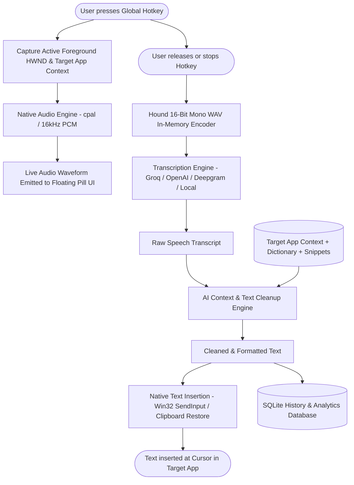

# AMIYO FLOW — PROJECT ARCHITECTURE

## 1. System Overview

AMIYO FLOW is a production-grade, cross-platform, universal AI voice typing desktop application. It captures speech from any microphone upon activating a global hotkey, streams or processes the audio through local or cloud speech-to-text models, cleanses and formats the transcript using context-aware AI intelligence, and automatically inserts the refined text directly into the active cursor position of any external desktop application (e.g., VS Code, Chrome, ChatGPT, Claude, Slack, Microsoft Word, Notion).



## 2. Technology Stack

### Frontend & UI
- **Framework**: Tauri 2 (Desktop harness) + React 18 / 19 + TypeScript
- **Bundler**: Vite
- **Styling**: Tailwind CSS + Framer Motion (ultra-smooth transitions & visualizer animations)
- **Icons**: Lucide React
- **State Management**: Zustand
- **Audio Visualizer**: HTML5 Canvas / Web Audio RMS Visualizer synchronized with native audio buffer levels

### Backend & Native Core
- **Language**: Rust (2021 Edition)
- **Audio Capture**: `cpal` (Native low-latency cross-platform audio I/O)
- **Audio Encoding**: `hound` (WAV stream generation)
- **Global Hotkeys**: `tauri-plugin-global-shortcut` / native Win32 `RegisterHotKey`
- **Native OS Integration**: `windows` crate / Win32 API (`GetForegroundWindow`, `SetForegroundWindow`, `SendInput`, `GetWindowTextW`, `AttachThreadInput`)
- **Database**: `rusqlite` (Embedded local SQLite with connection pooling)
- **HTTP / REST**: `reqwest` (Async multi-part audio upload and LLM completions)
- **Serialization**: `serde`, `serde_json`

### Speech & AI Pipeline
- **Transcription Engines**:
  - Groq Whisper Cloud (`whisper-large-v3`, `whisper-large-v3-turbo`)
  - OpenAI Whisper Cloud (`whisper-1`)
  - Deepgram Nova-2
  - Local Whisper HTTP / Offline fallback engine
- **Context & Text Cleanup Engine**:
  - Cloud LLM integrations (Groq Llama 3.3 70B, OpenAI GPT-4o-mini, Anthropic Claude 3.5 Haiku, Google Gemini)
  - Rule-based offline heuristic cleanup engine (fallback when offline or no API key configured)
  - Dictionary and technical jargon booster
  - Dynamic snippet expander
  - Style formatting (Casual, Professional, Academic, Developer, AI Prompt, Raw)

## 3. Directory Layout

```
amiyo-flow/
├── docs/                      # Architectural, QA, audit, and release documentation
├── src/                       # Frontend React + TypeScript application
│   ├── assets/                # Application logos, audio cues, branding
│   ├── components/            # Reusable UI components (Pill, Waveform, Modal, etc.)
│   │   ├── layout/            # Sidebar, Header, WindowFrame
│   │   ├── visualizer/        # Real-time audio waveform canvas
│   │   └── common/            # Buttons, Inputs, Badges, Cards
│   ├── pages/                 # The 10 primary functional pages
│   │   ├── Dashboard.tsx
│   │   ├── LiveDictation.tsx
│   │   ├── History.tsx
│   │   ├── Dictionary.tsx
│   │   ├── Snippets.tsx
│   │   ├── WritingStyles.tsx
│   │   ├── MeetingAssistant.tsx
│   │   ├── AIProviders.tsx
│   │   ├── Analytics.tsx
│   │   └── Settings.tsx
│   ├── stores/                # Zustand application stores
│   │   ├── useDictationStore.ts
│   │   ├── useSettingsStore.ts
│   │   ├── useHistoryStore.ts
│   │   └── useProviderStore.ts
│   ├── types/                 # Shared TypeScript interfaces
│   └── App.tsx
├── src-tauri/                 # Native Rust backend
│   ├── Cargo.toml
│   ├── tauri.conf.json
│   ├── build.rs
│   └── src/
│       ├── main.rs            # Tauri application entry point
│       ├── lib.rs             # Tauri command handlers & plugin setup
│       ├── audio/             # Native cpal audio capture & level metering
│       ├── input/             # Windows Win32 text insertion & focus tracking
│       ├── stt/               # Speech-to-text clients (Groq, OpenAI, etc.)
│       ├── ai/                # Text refinement, prompt styles, and heuristics
│       └── db/                # SQLite storage for history, dictionary, snippets
├── package.json
├── vite.config.ts
└── tailwind.config.js
```

## 4. Universal Text Insertion Strategy

The fundamental challenge in voice typing is delivering text reliably into foreign desktop windows without losing cursor positioning or corrupting target state.

AMIYO FLOW implements a triple-tier strategy:

1. **Pre-Capture HWND Lock**:
   - Immediately upon hotkey actuation, before opening or focusing any UI, the native thread invokes `GetForegroundWindow()`.
   - The thread queries the process name (e.g. `code.exe`, `chrome.exe`, `slack.exe`, `word.exe`) and window title.

2. **Window Re-Focus & Win32 SendInput Clipboard Paste**:
   - Once transcription and AI processing completes, the application reactivates the target window handle (`SetForegroundWindow`, with `AttachThreadInput` if needed).
   - The current clipboard content is backed up.
   - The cleaned text is written to the system clipboard.
   - A synchronized sequence of `VK_CONTROL` + `'V'` keyboard down and up events is dispatched via `SendInput`.
   - After a 35ms application processing buffer, the clipboard is safely restored.

3. **Unicode Character Stream Fallback**:
   - If clipboard paste is restricted or disabled by user setting, text is injected character-by-character via Win32 `KEYEVENTF_UNICODE` input records.

4. **Clipboard Direct Notification Fallback**:
   - If the target window has closed or cannot receive input, the text is retained in the clipboard and an OS notification alerts the user.
